# Flowchart

How VidHelp runs today, as built (7 Oct 2026). The first chart shows the whole app across roles; the rest show each module.

## 1. The whole app: host, operator, admin, finance

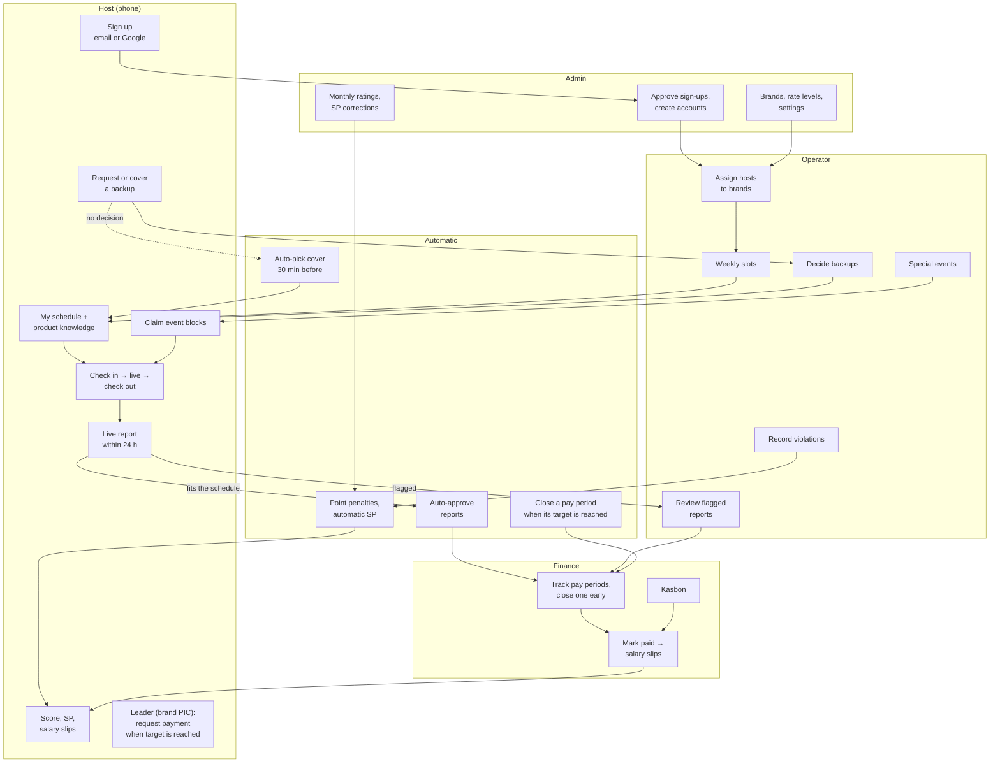

Every step that concerns someone sends a notice to the in-app bell, and to Discord when it is set up. Admins can do everything operators and finance can.

## 2. Accounts and sign-in

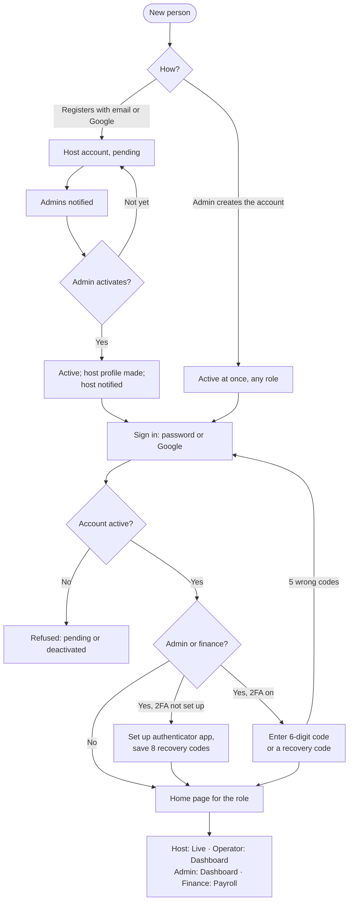

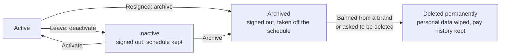

## 3. Brands, assignments and weekly schedule

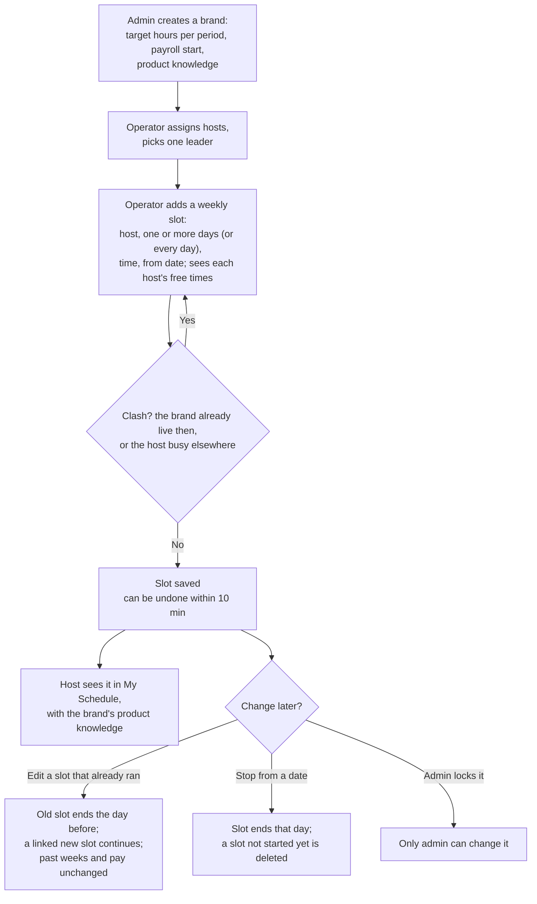

## 4. Backup (izin)

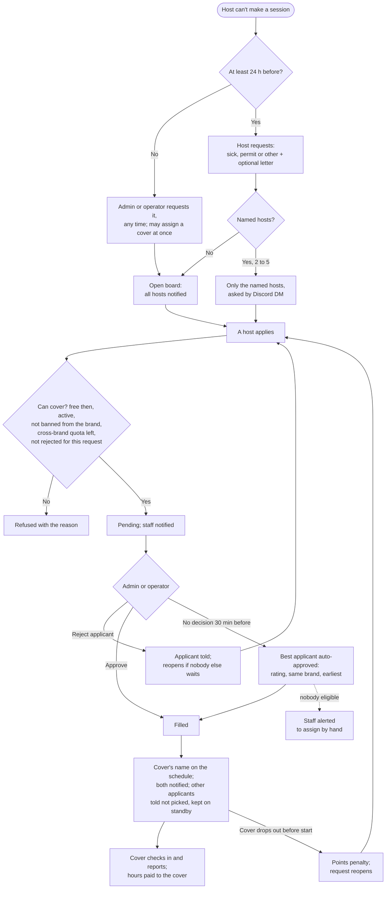

Cancelling: the requester can cancel until a cover is approved; staff can cancel any time. The cover and anyone still waiting are told.

## 5. Sick letter (surat sakit)

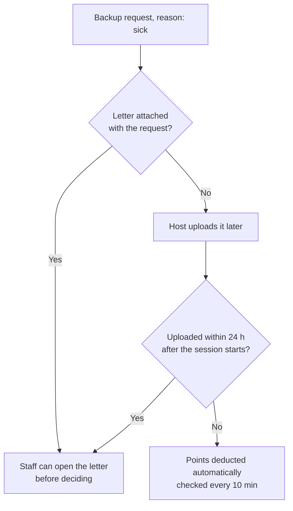

## 6. Attendance and live report

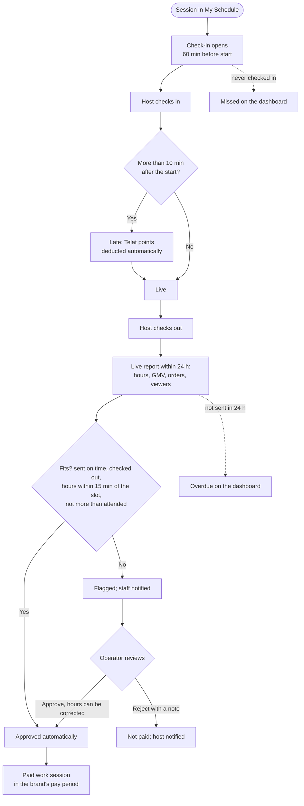

## 7. Special events (PD, double date)

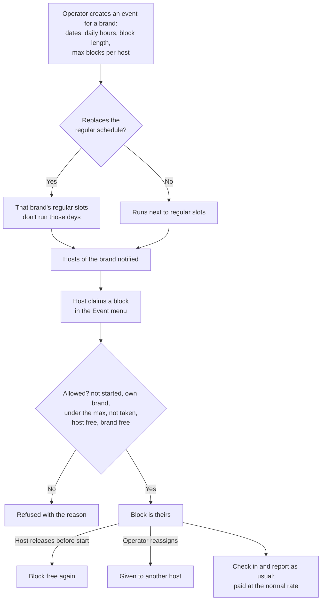

## 8. Points, warning letters (SP) and rating

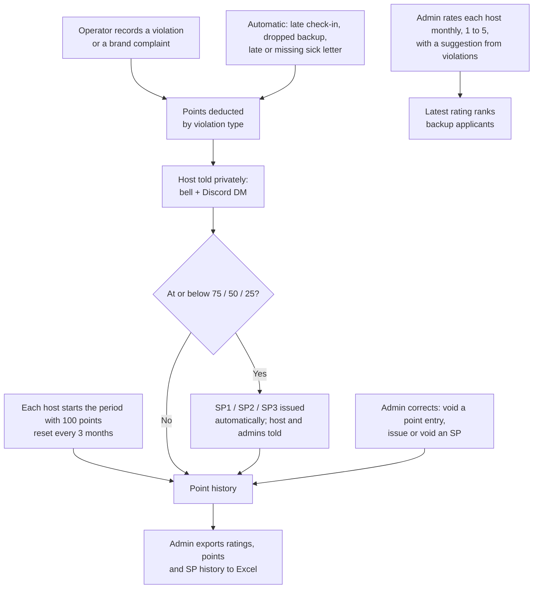

## 9. Payroll

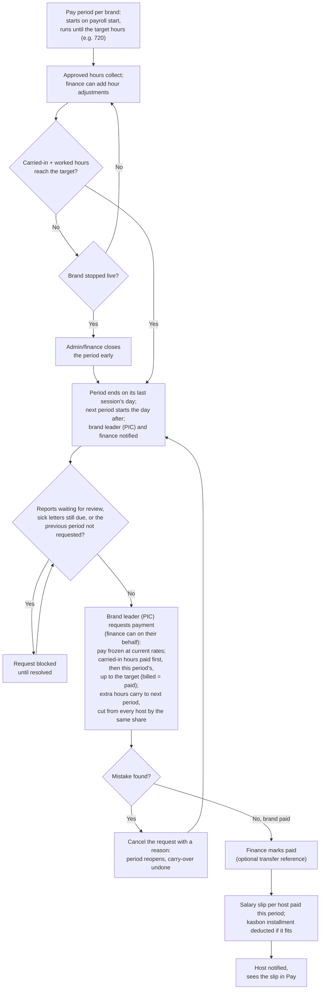

## 10. Kasbon

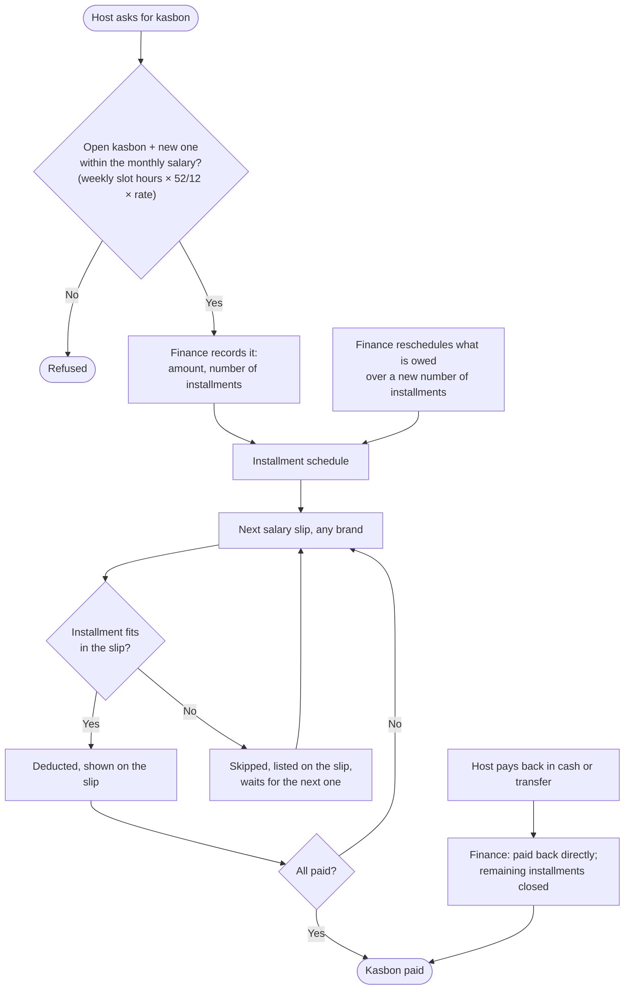

A kasbon can be deleted only before any installment is deducted.

## 11. Notifications

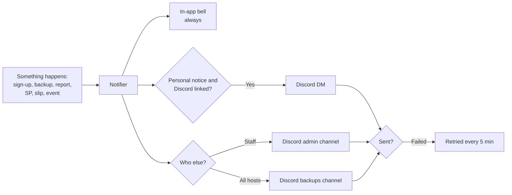

## 12. Settings, security and audit log

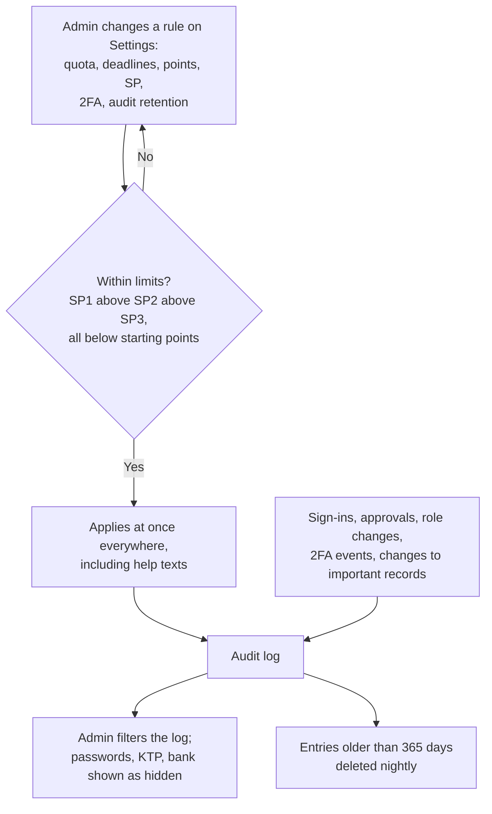
